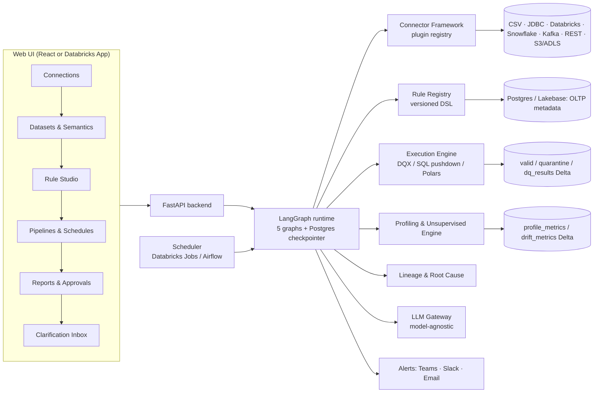
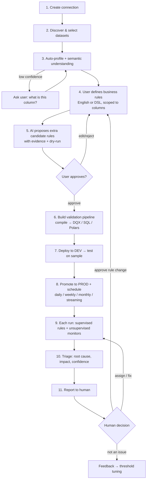
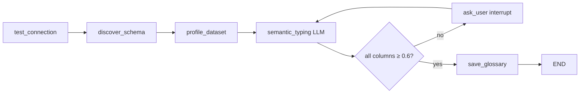
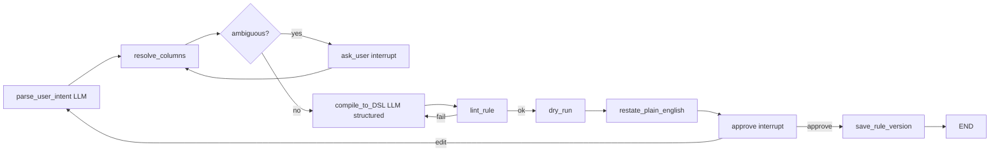
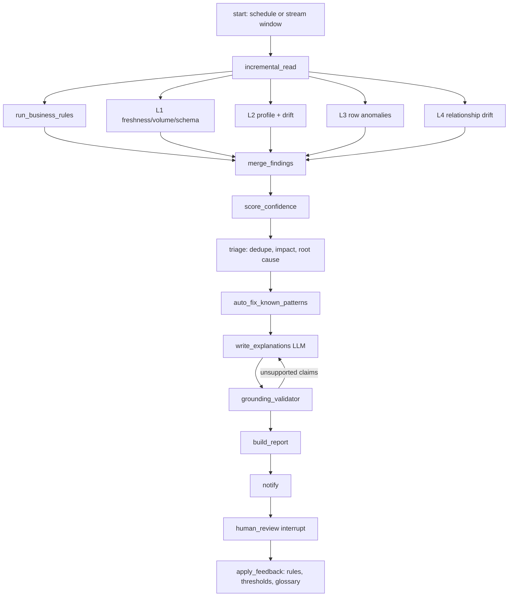

# AI Data Validation Agent — Full Build Plan (LangGraph)

> Working name: **FlowForge DQ** (it can reuse the FlowForge connector layer and LangGraph patterns)
> Author: Animesh Kumar Sinha · Draft v1 · October 30, 2026

---

## 0. One-paragraph summary

A LangGraph application that connects to any data source through pluggable connectors, lets users define business rules (in plain English or a rule DSL), compiles those rules into a validation pipeline, and then runs two validation layers on a schedule:

1. A **supervised layer**: the user's business rules, which always take priority.
2. An **unsupervised layer**: profiling, drift, anomaly and relationship monitoring that finds what nobody wrote a rule for.

Every finding carries a **confidence score backed by evidence**. When the agent doesn't understand a column or the evidence is weak, it says so and asks the user instead of guessing. A human approves every new or changed rule, and every decision is audited.

The design copies the proven mechanics from Databricks Data Quality Monitoring, Databricks Labs DQX, Anomalo and Monte Carlo, and adds what none of them do well together: multi-source connectors, natural-language rule authoring, a clarification loop, and an approval workflow.

---

## 1. What we copy from the market (and why)

| Capability | Who does it best | How it works there | What we build |
|---|---|---|---|
| Freshness check | Databricks anomaly detection | Builds a per-table model from commit history that predicts when the next commit should land; late commit → *stale* | Same: per-dataset model of update cadence, predicted next arrival, stale flag |
| Completeness (volume) | Databricks anomaly detection | Predicts an expected row-count range for the last 24h from history; below lower bound → *incomplete* | Same, plus configurable window (hourly / daily / weekly / monthly) |
| Percent-null per column | Databricks (Beta) | Predicts expected null % per column from history; above upper bound → *incomplete* | Same, for every column, plus % zero, % empty string, % NaN (Databricks explicitly does not cover these yet) |
| Slicing | Databricks (Beta) | Completeness per group of a column, up to 3 slice columns, only if ≤ 50 distinct values | Same rule, user-chosen slices (e.g., `region`, `banner`, `division`) |
| Intelligent scanning | Databricks | Scans important tables more often (popularity, downstream usage, certification); skips static/deprecated ones | Priority score per dataset → scan frequency |
| Training state | Databricks | Table shows *Training* until enough history exists to build a baseline | Same; no unsupervised verdicts until baseline is ready |
| Root cause via lineage | Databricks | Uses Unity Catalog lineage to decide whether the issue started in the table or upstream; surfaces failing upstream jobs | Same via UC lineage API; OpenLineage for non-Databricks sources |
| Impact (High/Medium/Low) | Databricks | Based on number of downstream tables and queries | Same |
| False-positive feedback | Databricks | "Not an issue" dismisses an incident (persists 7 days); "Assign to me" claims it | Same, plus the feedback retrains thresholds |
| Health indicator | Databricks | Healthy / Unhealthy / Training / Error / Excluded / Not enabled | Same states, shown per dataset and on the lineage graph |
| Results in a table | Databricks | Results land in `system.data_quality_monitoring.table_results` | Our own `dq_results` Delta table (queryable, alertable) |
| Profiling + drift | Databricks data profiling (ex-Lakehouse Monitoring) | Profile metrics table + drift metrics table, time granularity, slices, custom metrics, baseline comparison | Same two-table design |
| Rules as code + quarantine | Databricks Labs DQX | Profiler → rule candidates; rules in YAML; warn/error levels; drop / mark / quarantine; batch + streaming | **Use DQX directly** as the Spark execution backend |
| NL → rules | DQX (LLM extra) | Generates rules from natural-language requirements | Our own rule-authoring graph (multi-backend), with DQX as one target |
| Row-level anomaly + explanation | DQX v0.15 | Row anomaly detection; anomalous rows grouped by segment and top contributing features; explanation via `ai_query` | Same pattern; explanation must cite evidence (see §11) |
| Deep content anomalies | Anomalo | Unsupervised ML over actual row contents finds "unknown unknowns" (distribution shifts, odd values, hidden correlations) | Unsupervised layers L2–L4 (§9) |
| Five pillars + lineage | Monte Carlo | Freshness, volume, schema, distribution, lineage | Covered by L1–L2 + schema-change detector |
| Steward escalation + audit trail | Intellectyx (pattern) | Rules + schema + anomaly → flag / auto-fix known patterns → unresolved to steward with audit | Same flow (§12) |

**Decision:** don't reinvent the Spark execution engine. Use **DQX** for Databricks/Spark data, **SQL pushdown** for databases, and **pandas/Polars** for small files. Your product value is the layer *above* that: connectors, rule authoring, supervised + unsupervised fusion, confidence and clarification, approvals, and cross-source checks.

---

## 2. Design principles (non-negotiable)

1. **Business rules first.** User rules are the primary signal. Unsupervised findings are secondary and labeled as such.
2. **LLMs propose, code decides.** The LLM never computes a number, never declares pass/fail. All metrics and verdicts come from deterministic Spark/SQL/Python. The LLM only:
   - translates English to rule DSL,
   - suggests semantic types and candidate rules,
   - writes explanations from an evidence bundle.
3. **No evidence, no claim.** Every statement in a report links to a metric ID, rule-run ID or lineage edge. A validator node rejects any sentence that can't be traced.
4. **Say "I don't know."** Low confidence routes to a clarification question, never to a guess.
5. **Never mutate source data.** Like Databricks, validation adds no writes to the source and no overhead to source jobs. Outputs go to separate valid / quarantine / results tables.
6. **Human approval for every rule change.** AI-suggested rules stay *proposed* until approved. Every change is versioned and audited.
7. **Connectors are plugins.** Adding a source means adding one class, not changing the core.

---

## 3. High-level architecture



**Storage split** (the same one DQX Studio uses):
- **Postgres / Lakebase** holds OLTP data: connections, rules, settings, RBAC, comments, schedules, approvals.
- **Delta** holds analytical data: validation runs, profiles, quarantine, metrics, results.

---

## 4. End-to-end user workflow



---

## 5. Module 1 — Connector framework (open-ended plugins)

### 5.1 Connector contract

Every connector implements one interface. The core never knows which source it's talking to.

```python
from abc import ABC, abstractmethod
from pydantic import BaseModel
from typing import Iterator, Literal

class ConnectorCapabilities(BaseModel):
    batch: bool = True
    streaming: bool = False
    sql_pushdown: bool = False      # can run rule SQL at the source
    commit_history: bool = False    # enables freshness model (e.g., Delta history)
    lineage: bool = False           # e.g., Unity Catalog lineage
    sampling: bool = True

class DatasetRef(BaseModel):
    connection_id: str
    path: str                       # catalog.schema.table | db.schema.table | topic | file id

class BaseConnector(ABC):
    type_name: str                  # "databricks", "jdbc_postgres", "csv_upload", "kafka"...
    config_schema: type[BaseModel]  # drives the credential form in the UI
    capabilities: ConnectorCapabilities

    @abstractmethod
    def test_connection(self) -> tuple[bool, str]: ...
    @abstractmethod
    def list_datasets(self, prefix: str | None = None) -> list[DatasetRef]: ...
    @abstractmethod
    def get_schema(self, ds: DatasetRef) -> list[dict]: ...           # name, type, nullable, comment, tags
    @abstractmethod
    def sample(self, ds: DatasetRef, n: int = 10_000, seed: int = 42): ...
    @abstractmethod
    def read_batch(self, ds: DatasetRef, since: str | None = None): ...  # incremental by watermark
    def read_stream(self, ds: DatasetRef) -> Iterator: raise NotImplementedError
    def run_sql(self, sql: str): raise NotImplementedError              # if sql_pushdown
    def commit_history(self, ds: DatasetRef) -> list[dict]: return []   # ts, rows_added
    def lineage(self, ds: DatasetRef) -> dict: return {}                # upstream/downstream
```

### 5.2 Registry
- Connectors register through Python **entry points** (`flowforge_dq.connectors`), so a new connector ships as a separate package.
- The UI renders the credential form from `config_schema` (JSON Schema), so a new connector gets a UI page with zero frontend work.

### 5.3 Initial connectors

| Connector | Auth | Capabilities | Notes |
|---|---|---|---|
| CSV / Excel / Parquet upload | none | batch, sampling | Stored in a UC Volume or object storage; schema inferred, then confirmed by the user |
| JDBC SQL (Postgres, SQL Server, Oracle, MySQL) | user/password, Kerberos, Azure AD | batch, sql_pushdown | Rules compile to source SQL so data doesn't move |
| Databricks / Unity Catalog | Service principal (OAuth M2M) or PAT | batch, streaming, pushdown, commit_history, lineage | The richest connector: Delta history powers the freshness model, UC lineage powers RCA |
| Snowflake / BigQuery | key-pair / service account | batch, pushdown | |
| Kafka / Event Hubs | SASL/SSL, mTLS | streaming | Micro-batch windows; schema-registry aware |
| REST / API | OAuth2, API key | batch | Pagination + JSON flattening |
| S3 / ADLS / GCS | IAM role, SP | batch | Folder-as-dataset, partition aware |

### 5.4 Secrets
- Credentials never live in Postgres in plain text. Store a **reference** to Databricks secret scopes, Azure Key Vault, or HashiCorp Vault.
- `test_connection` runs before save. Credentials are scoped per user/team.

---

## 6. Module 2 — Dataset onboarding & semantic understanding

This is the **anti-hallucination foundation**. The agent must understand a column before it validates it.

### 6.1 Deterministic profile (no LLM)
Per column: type, null %, distinct count, top-k values, min/max/mean/std, quantiles (p1, p5, p25, p50, p75, p95, p99), length stats, regex pattern classes, % zero, % negative, monotonicity, inferred keys, candidate foreign keys (inclusion dependency tests across datasets).

### 6.2 Semantic typing agent (LLM, constrained)
- **Input:** column name, data type, UC comment/tags, profile stats, and up to 20 **masked** sample values.
- **Output:** a Pydantic object with:
  - `semantic_type` from a closed vocabulary (e.g., `price`, `cost`, `upc`, `store_id`, `promo_start_date`, `percent`, `currency_code`, `free_text`, `unknown`),
  - `confidence`,
  - `evidence[]`.
- **Confidence below 0.6 → status `NEEDS_CLARIFICATION`.** The question goes to the Clarification Inbox, e.g.:
  > "Column `cmp_px_adj` (decimal, 0.01–48.20, 3% null). Is this a competitor price? If yes, which currency, and is it per unit or per pack?"
- User answers are stored in a **business glossary** and reused across datasets with the same column names.

### 6.3 Readiness gate
A dataset can't move to rule authoring until every column used in a rule is either typed with confidence ≥ 0.6 or confirmed by the user.

---

## 7. Module 3 — Business rule definition (supervised layer)

### 7.1 Rule DSL (YAML, versioned)

```yaml
rule_id: price.cost_below_retail
version: 3
dataset: retail.pricing.item_price_daily
scope:
  columns: [unit_cost, retail_price]
  filter: "status = 'ACTIVE'"            # optional row filter
  slice_by: [division]                    # optional; results per slice
type: cross_column
expression: "unit_cost < retail_price"
severity: error                           # info | warn | error | critical
action: quarantine                        # flag | drop | quarantine | fail_pipeline
threshold:
  max_violation_pct: 0.5                  # the rule fails if > 0.5% of rows violate
origin: user                              # user | ai_suggested | ai_approved
owner: pricing-data-team
status: active                            # proposed | active | retired
description: "Unit cost must be below retail price for active items."
```

### 7.2 Rule type catalog

| Type | Example (retail data) |
|---|---|
| Not null / completeness | `item_id`, `store_id`, `effective_date` not null |
| Uniqueness | one price per (`item_id`, `store_id`, `effective_date`) |
| Range | `retail_price BETWEEN 0.01 AND 9999` |
| Set membership | `currency IN ('USD')`, `price_type IN ('REG','PROMO','CLEARANCE')` |
| Pattern / checksum | UPC-A 12 digits with a valid check digit |
| Cross-column | `unit_cost < retail_price`; `promo_start <= promo_end` |
| Temporal | promo window inside the ad week; `effective_date` not in the future |
| Referential | every `item_id` exists in the item master |
| Cross-dataset reconciliation | promo price in the promo table = price in the POS feed for the same week |
| Aggregate / statistical | daily row count of competitor prices within ±15% of the 4-week median |
| Band vs reference | competitor price within ±40% of our retail price for the same item |
| Freshness SLA | competitor feed lands by 6:00 AM ET daily |
| Custom SQL | anything else, as a predicate returning violating rows |

### 7.3 Natural-language authoring flow
1. The user types: *"Promo price should always be lower than regular price, but only for active promos."*
2. The **Rule Compiler** node (LLM with structured output) produces the DSL. It may only reference columns that exist and have confirmed semantics.
3. A **Rule Linter** (deterministic) checks:
   - columns exist,
   - types are compatible,
   - the expression parses (sqlglot),
   - no full scans on huge tables without a filter.
4. A **Dry Run** executes the rule on a sample and shows violation count, % and 10 example violating rows.
5. The user sees three views side by side: **plain-English restatement**, **SQL**, and **dry-run result**. Then they approve, edit, or reject.
6. If the LLM can't map a phrase to a column (e.g., "regular price" is ambiguous), it asks; it doesn't pick one.

### 7.4 Multi-backend compilation
One DSL compiles to several targets, the same idea as FlowForge's multiple code targets:
- **DQX** checks (Spark batch + streaming, with quarantine)
- **Lakeflow expectations** (`expect` / `expect_or_drop` / `expect_or_fail`) when the user wants checks inside an existing pipeline
- **Source SQL** (pushdown for JDBC / Snowflake)
- **Polars** (uploaded files)

---

## 8. Module 4 — AI-recommended rules

Two sources of candidates, both **proposed only**:

1. **Profile-driven (deterministic, DQX-style):** the profiler output generates candidates — not-null where null % is 0 historically, ranges from p0.5–p99.5, set membership for low-cardinality columns, uniqueness for observed keys.
2. **Semantics-driven (LLM):** from confirmed semantic types, e.g.:
   - `upc` → check-digit rule,
   - `promo_start/promo_end` → ordering rule,
   - `cost` + `price` → cost < price.

Each candidate shows:
- its evidence (the stats that led to it),
- a dry-run violation rate on the last N days,
- the expected alert rate per month,
- a confidence score.

Rules that would have fired on > 20% of historical runs are flagged as *likely noisy*.

---

## 9. Module 5 — Unsupervised monitoring engine

This answers "regressions, heat maps, and multiple ways AI finds problems". It runs in four layers, cheapest first.

### L1 — Table metadata (copy Databricks)
- **Freshness:** model inter-arrival times of commits; predict the next arrival with a seasonal baseline (day-of-week, hour); stale if late beyond the upper bound.
- **Volume:** predict an expected row range per window with seasonality (STL decomposition or Prophet); incomplete if below the lower bound, *surge* if above the upper bound.
- **Schema change:** added / removed / retyped columns since the last run.

### L2 — Column distribution & drift (copy Databricks data profiling)
- Per window: null %, zero %, distinct count, quantiles, mean/std, top-k categories.
- Predict an expected band per metric from history (rolling median ± k·MAD, or a seasonal forecast).
- **Drift tests** vs a baseline window and vs the previous window:
  - numeric: KS test, Wasserstein distance, PSI,
  - categorical: chi-square, Jensen–Shannon distance.
- Use effect size, not just p-values. On large tables everything is "significant", so gate on PSI > 0.2 or JS > 0.1, *and* p < 0.01.
- **Slices:** run the same per slice column (≤ 50 distinct values, the same limit Databricks uses).

### L3 — Row-level anomaly detection (copy DQX + Anomalo)
- Models: Isolation Forest (default), ECOD (fast, parameter-free), optional autoencoder for wide tables.
- Features: numeric columns + encoded low-cardinality categoricals + derived ratios (e.g., `retail_price / unit_cost`).
- Output: anomaly score per row. Group anomalous rows by **segment** and **top contributing features** (SHAP or per-feature isolation depth), as DQX does, so the report says "12,400 rows in division 014 have abnormal `retail_price / unit_cost`" instead of listing rows.

### L4 — Relationship drift (the "regression / heat map" idea)
- **Correlation heat map drift:** compute the Pearson/Spearman matrix per window, then alert on cells where |Δρ| > 0.3, e.g., `competitor_price` and `retail_price` normally correlate at 0.85 and suddenly drop to 0.3.
- **Learned relationships:** fit simple regressions between semantically linked columns (e.g., `retail_price ~ unit_cost` per category) and track coefficients and residual distribution over time. A coefficient jump or residual widening is a finding.
- **Functional dependencies:** discovered FDs (e.g., `item_id → department`) that start breaking.
- **Metric forecasting:** business KPIs from the data itself (avg price per department, promo count per week) forecast with seasonality; out-of-band → finding.

### Guards for the unsupervised layer
- **Training state:** no verdicts until the baseline has enough observations (default ≥ 14 windows for daily data, ≥ 8 for weekly). Show *Training* like Databricks does.
- **Intelligent scanning:** priority = f(downstream consumers from lineage, certification tag, query volume, recent incidents). High-priority datasets get all four layers at every run. Low-priority ones get L1 only, and full scans weekly.
- **Unsupervised findings never fail a pipeline.** They create incidents; only approved rules can quarantine or fail.

---

## 10. Module 6 — Supervised drift on business rules

Business rules aren't just pass/fail per run. The agent also tracks them over time:
- **Violation-rate trend** per rule (and per slice). A rule passing with 0.4% violations against a 0.5% threshold, after weeks at 0.05%, is a **drift warning** before it becomes a failure.
- **Rule health:**
  - Never fired in 90 days → maybe too loose; suggest tightening, with evidence.
  - Fires every run → maybe wrong or the threshold is unrealistic; suggest a review.
  - Correlated with an unsupervised finding → raise that finding's confidence.
- **Fusion:** if a rule violation and an L2/L3 anomaly hit the same columns in the same window, merge them into one incident with higher confidence.

---

## 11. Anti-hallucination & confidence framework

### 11.1 Where hallucination can happen, and the control for each

| Risk | Control |
|---|---|
| LLM invents a column or misreads its meaning | Closed vocabulary; columns must exist in the schema; semantic confidence gate (§6.3) |
| LLM writes a wrong rule | Linter + dry run + plain-English restatement + human approval |
| LLM invents numbers in reports | LLM gets an **evidence bundle** with IDs; a validator node checks every number and claim against it; unsupported sentences are removed |
| LLM invents a root cause | RCA uses only lineage edges and job-run facts; the LLM may rank and phrase them, not create them |
| Weak statistics presented as fact | Confidence score (below); low confidence is labeled and routed to clarification |

### 11.2 Confidence score per finding

```
confidence = w1·semantic_confidence      # do we understand the columns involved?
           + w2·statistical_strength     # effect size, p-value, distance from band
           + w3·baseline_maturity        # how much history the model has
           + w4·signal_agreement         # rule + unsupervised + lineage agree?
           - w5·recent_false_positive_rate
```
Start with w = (0.25, 0.30, 0.15, 0.20, 0.10) and tune on labeled incidents (§15).

| Score | Behaviour |
|---|---|
| ≥ 0.80 | Reported as a finding; alerts sent |
| 0.50 – 0.79 | Reported, labeled **"Needs review"**; no paging |
| < 0.50 | **"Validation is weak — low confidence."** Not reported as a defect. A clarification question is created with what the agent doesn't know and what input would resolve it (e.g., "confirm the unit of `cmp_px_adj`", "provide 2 more weeks of history", "is a 30% weekend drop normal?") |

### 11.3 Clarification Inbox
- One queue of questions per dataset owner, with answer types: choice, number, free text, or "attach reference data".
- Answers update the glossary, rule parameters or seasonality settings, then re-trigger scoring.
- In LangGraph, the graph pauses with `interrupt()` and resumes when the answer arrives (Postgres checkpointer).

---

## 12. Module 7 — Triage, root cause, auto-fix, report

### 12.1 Triage
1. **Dedupe & merge:** findings on the same dataset/columns/window become one incident.
2. **Impact:** downstream tables, dashboards, jobs and query volume from lineage → High / Medium / Low.
3. **Root cause (Databricks-style):**
   - Walk lineage upstream: is an upstream dataset also unhealthy?
   - Did an upstream job fail, run late, or change code (job run history, git SHA)?
   - Did a schema change land?
   - Pick the most upstream unhealthy node with a supporting fact.
4. **Auto-fix known patterns** (only from an approved playbook, never invented):
   - trim/upper-case codes,
   - re-derive a UPC check digit,
   - map known currency codes,
   - de-duplicate exact duplicates.

   Auto-fixed rows always go to a corrected table, never back to the source, and the fix is logged.

### 12.2 Report (per run, per dataset)
- **Header:** health status, run window, rows scanned, confidence summary.
- **Business rules:** pass/fail per rule, violation %, trend sparkline, quarantined count.
- **Unsupervised findings:** L1–L4 with charts — the predicted band vs observed, drift distances, the correlation heat map delta, top anomalous segments.
- **Root cause & impact** for each incident.
- **Recommendations:** each one either a proposed rule change or a proposed new rule, with evidence and dry-run results.
- **Weak validations:** the open clarification questions.
- **Actions per item:** Approve · Reject · Not an issue · Assign to me · Edit.

### 12.3 Approval loop
- *Approve rule change* → new rule version, status `active`; the old version is kept.
- *Not an issue* → incident closed; this pattern is down-weighted (false-positive feedback); suppressed for 7 days by default.
- All actions are written to `audit_log` (who, what, when, before/after).

---

## 13. LangGraph design

Five graphs. Each one is a compiled `StateGraph` with a Postgres checkpointer, so human pauses can last days.

### 13.1 Shared state (simplified)

```python
from typing import TypedDict, Literal, Annotated
import operator

class Finding(TypedDict):
    finding_id: str
    layer: Literal["rule", "L1", "L2", "L3", "L4"]
    dataset: str
    columns: list[str]
    metric_ids: list[str]          # evidence pointers
    observed: float
    expected_low: float | None
    expected_high: float | None
    confidence: float
    status: Literal["finding", "needs_review", "weak"]

class DQState(TypedDict):
    run_id: str
    connection_id: str
    dataset: str
    schema: list[dict]
    profile_id: str | None
    semantics: dict[str, dict]                 # column -> {type, confidence, evidence}
    rules: list[dict]                          # active rules (DSL)
    proposed_rules: list[dict]
    rule_results: list[dict]
    findings: Annotated[list[Finding], operator.add]
    incidents: list[dict]
    clarifications: Annotated[list[dict], operator.add]
    report_md: str | None
    approvals: list[dict]
    errors: Annotated[list[str], operator.add]
```

### 13.2 Graph 1 — Onboarding



### 13.3 Graph 2 — Rule authoring


Plus a parallel **suggest_rules** branch (profile-driven + semantics-driven) that writes to `proposed_rules`.

### 13.4 Graph 3 — Pipeline build & deploy
`load_active_rules → choose_backend (DQX | SQL | Polars) → generate_code → unit_test_on_sample → deploy_dev (Bundles) → run_dev → compare_expected → approve_promote (interrupt) → deploy_prod → register_schedule`

### 13.5 Graph 4 — Monitoring run (scheduled)


The five checks fan out in parallel with the `Send` API and fan back in at `merge_findings`.

### 13.6 Graph 5 — Triage chat (on demand)
A ReAct-style agent the user can ask "why did item_price_daily go unhealthy yesterday?"
- **Tools:** `get_incident`, `get_metric_history`, `get_lineage`, `get_job_runs`, `run_readonly_sql`, `compare_windows`.
- Read-only tools only. Answers must cite metric/run IDs.

### 13.7 Tools exposed to agents (all deterministic)
`profile(dataset)`, `dry_run(rule, sample)`, `lint(rule)`, `get_metric_history(metric, window)`, `drift_test(col, base, cur)`, `anomaly_segments(run_id)`, `lineage(dataset, depth)`, `job_runs(job_id)`, `read_glossary(term)`, `run_readonly_sql(sql)` (allow-listed, row-capped).

Optionally expose them through an **MCP server**, so other agents (e.g., the Domain Search agents) can ask for dataset health.

---

## 14. Data model

**Postgres / Lakebase (OLTP)**
- `connections(id, type, config_ref, owner, created_at)`
- `datasets(id, connection_id, path, priority, certified, status)`
- `column_semantics(dataset_id, column, semantic_type, confidence, source[ai|user], updated_by)`
- `glossary(term, definition, unit, examples)`
- `rules(rule_id, version, dataset_id, dsl_yaml, origin, status, owner, created_by, approved_by)`
- `schedules(dataset_id, cron, mode[batch|stream], env)`
- `clarifications(id, dataset_id, question, answer_type, status, answer, answered_by)`
- `approvals(id, object_type, object_id, decision, actor, comment, ts)`
- `audit_log(id, actor, action, object, before, after, ts)`

**Delta (analytics)**
- `dq_results(run_id, dataset, rule_id|monitor, slice, observed, expected_low, expected_high, status, confidence, ts)`
- `profile_metrics(dataset, column, slice, window_start, window_end, metric, value)`
- `drift_metrics(dataset, column, slice, window, test, statistic, p_value, baseline_window)`
- `anomaly_segments(run_id, dataset, segment, top_features, row_count, score_p95)`
- `incidents(incident_id, dataset, findings[], impact, root_cause, confidence, status, assignee)`
- `<dataset>_quarantine`, `<dataset>_corrected`

---

## 15. Evaluating the agent itself

You need numbers before anyone trusts it.

1. **Seeded-defect benchmark.** Take clean historical windows and inject known defects:
   - null bursts,
   - duplicate loads,
   - unit errors (×100 prices),
   - late arrivals,
   - category drift,
   - broken joins,
   - swapped columns.

   Measure detection **precision, recall, F1** and **time-to-detect** per defect type and per layer.
2. **Rule-compilation accuracy.** A test set of ~100 English rules with gold DSL. Measure exact-match and execution-match (same violating rows).
3. **Hallucination rate.** Count report sentences flagged by the grounding validator, plus human spot-checks. Target: 0 unsupported numeric claims in shipped reports.
4. **Calibration.** Plot confidence vs actual true-positive rate from human labels (Approve vs Not an issue). Re-fit weights monthly.
5. **Alert load.** Incidents per dataset per week. Target: high-priority datasets under 2/week, or people start ignoring alerts.

---

## 16. Security & governance
- Run under a **service principal** per environment. Respect Unity Catalog ACLs: the agent can only read what that principal can read, and users only see results for datasets they have `SELECT` on.
- **Minimize what the LLM sees:**
  - send profiles and statistics, not raw rows,
  - mask sample values (PII detection before any LLM call),
  - use an in-workspace model serving endpoint where possible.
- Read-only by default. Writes go only to the validation output schema.
- Full audit trail; rule versions are immutable.

---

## 17. Tech stack

| Layer | Choice |
|---|---|
| Orchestration | LangGraph (+ LangGraph Postgres checkpointer), model-agnostic LLM gateway (same approach as FlowForge) |
| API | FastAPI, Pydantic v2 |
| UI | React + a charting library (or a Databricks App for a faster internal rollout) |
| Execution | Databricks Labs DQX (Spark), sqlglot (SQL generation/transpile), Polars (files) |
| Stats / ML | scipy (KS, chi-square), numpy (PSI, JS), statsmodels (STL), PyOD (Isolation Forest, ECOD), shap |
| Lineage | Unity Catalog lineage API; OpenLineage for other sources |
| Scheduling | Databricks Jobs (via Declarative Automation Bundles) or Airflow |
| Stores | Postgres / Lakebase (OLTP), Delta (analytics) |
| Observability of the agent | LangSmith or MLflow tracing |
| Alerts | Teams / Slack webhooks, email |

---

## 18. Phased roadmap

| Phase | Weeks | Scope | Exit criteria |
|---|---|---|---|
| **0. Baseline** | 1 | Turn on Databricks Data Quality Monitoring for the target schemas; capture its results as a comparison baseline | Health indicators live; baseline incidents recorded |
| **1. MVP** | 2–6 | Connector SDK + 3 connectors (CSV upload, Databricks, one JDBC); profiling; semantic typing + clarification; rule DSL + NL authoring + dry run; DQX execution; batch schedule; simple report; approval loop | 5 real datasets with 20+ approved rules running daily in DEV |
| **2. Unsupervised v1** | 7–10 | L1 + L2 (freshness, volume, null %, drift, slices); training state; confidence scoring; incidents; alerts | Seeded benchmark: recall ≥ 0.8 for L1/L2 defects, < 2 alerts/week per dataset |
| **3. Deep detection** | 11–15 | L3 row anomalies + segment grouping; L4 correlation/regression drift; lineage RCA; grounding validator; triage chat | RCA correct on ≥ 70% of benchmark incidents; 0 unsupported claims |
| **4. Scale & streaming** | 16–20 | Kafka connector + micro-batch; intelligent scanning; DEV→PROD promotion; auto-fix playbook; feedback-tuned thresholds | Running in PROD on the full target domain |
| **5. Platform** | 21+ | MCP server, more connectors, multi-tenant RBAC, cost dashboard, rule marketplace across domains | Second domain onboarded without code changes |

---

## 19. Build vs reuse — final recommendation

- **Reuse:**
  - Databricks Data Quality Monitoring as the always-on baseline for freshness/completeness on UC tables (it's one click and cheap),
  - DQX as the Spark rule engine,
  - scipy / PyOD for statistics,
  - UC lineage for RCA.
- **Build:**
  - the connector SDK,
  - semantic understanding + clarification loop,
  - NL rule authoring with multi-backend compilation,
  - supervised + unsupervised fusion and confidence scoring,
  - the approval/audit workflow,
  - cross-source reconciliation.

  None of the market tools does all of this together, and that's the product.
- **Don't build:** your own Spark rule engine, your own drift statistics library, or your own lineage capture.

---

## 20. Open questions to settle before Phase 1
1. Which 5 datasets go first? A suggested mix: item master, item price daily, promo, cost, competitor price.
2. Which LLM endpoint is approved for use with profile stats and masked samples?
3. UI: a standalone React app or a Databricks App?
4. Who are the data stewards per dataset? They own the Clarification Inbox and approvals.
5. Alert channels and on-call expectations.
6. Retention for quarantine and results tables.

---

## 21. References
- Databricks — Data Quality Monitoring at scale with agentic AI (Feb 2026): https://www.databricks.com/blog/data-quality-monitoring-scale-agentic-ai
- Databricks docs — Anomaly detection (freshness, completeness, percent null, slicing, root cause, health indicators): https://docs.databricks.com/aws/en/data-governance/unity-catalog/data-quality-monitoring/anomaly-detection/
- Databricks docs — Data quality monitoring overview and data profiling: https://docs.databricks.com/gcp/en/data-governance/unity-catalog/data-quality-monitoring/
- Databricks Labs DQX — user guide (profiling, rule generation, DLT expectations): https://databrickslabs.github.io/dqx/docs/guide
- DQX v0.15.0 release notes (row-level anomaly explanations, DQX Studio storage split): https://github.com/databrickslabs/dqx/releases/tag/v0.15.0
- Anomalo — Monte Carlo vs. Anomalo (metadata observability vs content-level unsupervised detection): https://www.anomalo.com/blog/monte-carlo-vs-anomalo/
- Intellectyx — Data Validation AI Agent (rules + schema + anomaly → flag/auto-fix → steward escalation): https://www.intellectyx.com/data-validation-ai-agent/
